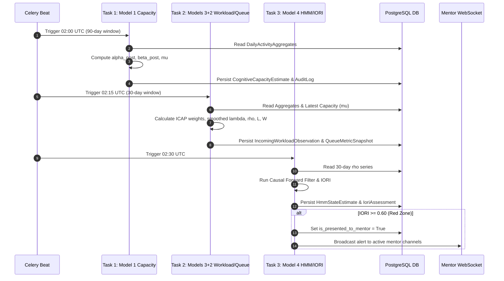

# COGLEARN Platform Architecture Specification

> **Platform**: Intelligent Learning and Cognitive Risk Management Platform  
> **Target Version**: 0.1.0  
> **Status**: Production Architecture & Mathematical Specification  

---

## Table of Contents
1. [System Overview](#1-system-overview)
2. [Technology Stack](#2-technology-stack)
3. [Multi-Tenant Architecture](#3-multi-tenant-architecture)
4. [The Four Mathematical Models](#4-the-four-mathematical-models)
   - [Model 1: Bayesian Capacity Estimation](#model-1-bayesian-capacity-estimation-mu)
   - [Model 2: M/M/1 Queueing Workload Assessment](#model-2-mm1-queueing-workload-assessment)
   - [Model 3: ICAP-Weighted Workload Quantification](#model-3-icap-weighted-workload-quantification-lambda)
   - [Model 4: Hidden Markov Model & IORI](#model-4-hidden-markov-model--iori)
5. [Analytics Pipeline](#5-analytics-pipeline)
6. [PROVISIONAL Parameter Registry](#6-provisional-parameter-registry)
7. [API Design & Schema Separation Matrix](#7-api-design--schema-separation-matrix)
8. [Academic Task Queue Design](#8-academic-task-queue-design)
9. [Calendar & Deadline Management](#9-calendar--deadline-management)
10. [Notification System](#10-notification-system)
11. [Mentor Intervention Engine](#11-mentor-intervention-engine)
12. [Institutional Analytics & Privacy Protections](#12-institutional-analytics--privacy-protections)
13. [Known Limitations](#13-known-limitations)
14. [Acceptance Test Scenarios (Part J - 27 Scenarios)](#14-acceptance-test-scenarios-part-j---all-27)

---

## 1. System Overview

**COGLEARN** is a university learning management platform and cognitive risk management system. Traditional LMS environments treat student activity as passive engagement metrics (e.g., page views, video completion percentages) without considering cognitive load constraints or academic bottlenecks. 

COGLEARN treats academic coursework as a stochastic queueing network operating against human cognitive capacity constraints. By combining:
1. Chi & Wylie's **ICAP framework** (Interactive, Constructive, Active, Passive) to quantify incoming academic cognitive demand ($\lambda$),
2. **Conjugate Bayesian Poisson-Gamma estimation** to model individual and cohort processing capacity ($\mu$),
3. **M/M/1 queueing theory** to detect structural demand-capacity imbalances ($\rho = \lambda / \mu$), and
4. A **Four-State Hidden Markov Model (HMM)** with causal Forward Filtering to infer latent cognitive states (**Underload**, **Flow**, **Overload**, **Fatigue**) and compute the **Index of Overload and Risk of Ineffectiveness (IORI)**,

COGLEARN provides academic mentors with early-warning capabilities before academic failure or severe cognitive burnout occurs, while strictly safeguarding student privacy.

```
                      +---------------------------------------+
                      |       Student LMS Interactions        |
                      | (Telemetry: clicks, views, submissions)|
                      +-------------------+-------------------+
                                          |
                                          v
                      +---------------------------------------+
                      |   Model 3: ICAP Workload Aggregator   |
                      |   lambda_raw(t) -> 3-day causal avg   |
                      +-------------------+-------------------+
                                          |
                +-------------------------+-------------------------+
                |                                                   |
                v                                                   v
+-------------------------------+               +-----------------------------------+
|  Model 1: Bayesian Capacity   |               |    Model 2: M/M/1 Queue Engine    |
|  mu ~ Gamma(alpha_post, beta) |               |  rho = lambda / mu, L, W metrics  |
+---------------+---------------+               +-----------------+-----------------+
                |                                                   |
                +-------------------------+-------------------------+
                                          |
                                          v
                      +---------------------------------------+
                      |   Model 4: 4-State HMM Forward Filter |
                      |    [Underload, Flow, Overload, Fatig.]|
                      +-------------------+-------------------+
                                          |
                                          v
                      +---------------------------------------+
                      |  IORI Calculation & Risk Assessment   |
                      |  Green (<0.35), Yellow, Red (>=0.65)  |
                      +-------------------+-------------------+
                                          |
                 +------------------------+------------------------+
                 |                                                 |
                 v                                                 v
+---------------------------------+               +---------------------------------+
| Student View (Privacy Filtered) |               | Mentor Intervention Dashboard   |
| Clean LMS, Deadlines, Tasks     |               | Real-time alerts, IORI telemetry|
| NO IORI / NO HMM Probabilities  |               | Support actions, extensions     |
+---------------------------------+               +---------------------------------+
```

---

## 2. Technology Stack

| Layer | Component | Choice | Justification |
| :--- | :--- | :--- | :--- |
| **Backend Framework** | FastAPI (Python 3.12+) | High-performance asynchronous ASGI framework with automated OpenAPI documentation and native dependency injection. |
| **ORM & DB Access** | SQLAlchemy 2.0 (Async) | Strict declarative `Mapped[]` and `mapped_column()` typing, native async engine with `asyncpg` driver. |
| **Data Validation** | Pydantic v2 | High-throughput Rust-backed validation with `model_config` and field validators. |
| **Relational Database** | PostgreSQL 15 | Native JSONB indexing, transactional integrity, and Row-Level Security (RLS) tenant isolation. |
| **Task Queue** | Celery 5.4 + Redis 7 | Asynchronous background processing for nightly model execution, queue maintenance, and scheduled notifications. |
| **Beat Scheduler** | Celery Beat | Precision crontab scheduling for Model 1 (02:00 UTC), Models 2+3 (02:15 UTC), Model 4 (02:30 UTC), and hourly task scans. |
| **Authentication** | RS256 Asymmetric JWT | Private key signing in backend, public key token verification with tenant claim enforcement and refresh token family rotation. |
| **Frontend Framework**| React 18 + TypeScript | Component-driven UI architecture, strict compile-time types for role separation. |
| **State & Query** | TanStack Query + Zustand | Server state synchronization, caching, and client UI state management. |
| **CSS Architecture** | Tailwind CSS | Utility-first responsive styling with accessible contrast ratios. |

---

## 3. Multi-Tenant Architecture

COGLEARN enforces strict multi-tenant isolation across all 36 data entities. Every institutional customer represents an isolated tenant domain.

### 3.1 Tenant Isolation Rules
1. **Schema-Level Multi-Tenancy**: Every database table contains `institution_id: Mapped[UUID]`, foreign-keyed to `institutions.id` with `ON DELETE CASCADE`.
2. **Platform Admin Exception**: Platform Administrator accounts maintain `institution_id = NULL` to supervise institutional provisioning.
3. **Session-Level Row-Level Security (RLS)**: PostgreSQL connection sessions execute `SET LOCAL app.current_tenant_id = :tenant_id` at transaction entry.
4. **JWT Tenant Binding**: Every minted JWT token contains `tenant_id: str` claim inside the payload.
5. **Dependency Enforcement**: The FastAPI dependency `get_current_active_user` and `get_tenant_db` verifies that the requested route parameter or payload `institution_id` matches the caller's JWT `tenant_id`.

```sql
-- PostgreSQL Row-Level Security Policy Pattern
ALTER TABLE academic_tasks ENABLE ROW LEVEL SECURITY;

CREATE POLICY tenant_isolation_policy ON academic_tasks
  FOR ALL
  USING (
    institution_id = NULLIF(current_setting('app.current_tenant_id', true), '')::uuid
  );
```

---

## 4. The Four Mathematical Models

### Model 1: Bayesian Capacity Estimation ($\mu$)

#### Purpose & Theory
Model 1 infers a student's cognitive processing capacity $\mu$ (effective workload units processable per day). Cognitive capacity is modeled not as a static constant, but as an unobserved positive random variable with a conjugate Gamma prior updated by daily empirical activity counts through a Poisson likelihood.

#### Mathematical Formulation

##### 1. Conjugate Prior Distribution
The prior distribution over capacity $\mu$ follows a Gamma distribution with hyperparameters $\alpha_0$ and $\beta_0$:

$$\mu \sim \text{Gamma}(\alpha_0, \beta_0)$$

$$\pi(\mu) = \frac{\beta_0^{\alpha_0}}{\Gamma(\alpha_0)} \mu^{\alpha_0 - 1} e^{-\beta_0 \mu}, \quad \mu > 0$$

- Default institutional prior parameters: $\alpha_0 = 10.0, \beta_0 = 2.0$ (**PROVISIONAL**).
- Prior expected capacity: $\mathbb{E}[\mu_0] = \frac{\alpha_0}{\beta_0} = \frac{10.0}{2.0} = 5.0$ workload units/day.
- Prior variance: $\text{Var}(\mu_0) = \frac{\alpha_0}{\beta_0^2} = \frac{10.0}{4.0} = 2.5$.

##### 2. Likelihood Function
Given $n$ daily observations of valid cognitive actions $X = (x_1, x_2, \dots, x_n)$ where $x_i \sim \text{Poisson}(\mu)$:

$$P(X \mid \mu) = \prod_{i=1}^n \frac{\mu^{x_i} e^{-\mu}}{x_i!} = \frac{\mu^{\sum_{i=1}^n x_i} e^{-n\mu}}{\prod_{i=1}^n x_i!}$$

##### 3. Posterior Distribution
Through Gamma-Poisson conjugacy, the posterior distribution is analytically exact:

$$\mu \mid X \sim \text{Gamma}(\alpha_{\text{post}}, \beta_{\text{post}})$$

$$\alpha_{\text{post}} = \alpha_0 + \sum_{i=1}^n x_i$$

$$\beta_{\text{post}} = \beta_0 + n$$

##### 4. Point Estimates & Credible Intervals
- **Posterior Mean**:
  $$\mathbb{E}[\mu \mid X] = \frac{\alpha_{\text{post}}}{\beta_{\text{post}}}$$

- **Posterior Variance**:
  $$\text{Var}(\mu \mid X) = \frac{\alpha_{\text{post}}}{\beta_{\text{post}}^2}$$

- **95% Credible Interval**:
  $$[\text{CI}_{\text{lower}}, \text{CI}_{\text{upper}}] = \left[ F^{-1}(0.025; \alpha_{\text{post}}, \beta_{\text{post}}), \; F^{-1}(0.975; \alpha_{\text{post}}, \beta_{\text{post}}) \right]$$
  where $F^{-1}(p; \alpha, \beta)$ is the quantile function (inverse CDF) of $\text{Gamma}(\alpha, \beta)$.

##### 5. Anomaly Detection & Outlier Rejection
Before ingestion into the posterior update, telemetry clicks are filtered using an Interquartile Range (IQR) filter:
$$x_i \text{ is anomalous if } x_i > Q_3 + 3.0 \cdot \text{IQR}$$
Filtered anomalous events increment `anomalous_click_count` and are excluded from $\sum x_i$ to prevent automated bot scripts or rapid accidental clicking from skewing capacity estimation.

---

### Model 2: M/M/1 Queueing Workload Assessment

#### Purpose & Theory
Model 2 applies Kendall's classic $M/M/1$ queueing model to academic workload management. Course tasks, quizzes, reading assignments, and project deliverables arrive at rate $\lambda$ (from Model 3) and are serviced at rate $\mu$ (from Model 1).

#### Mathematical Formulation

##### 1. Traffic Intensity / Utilization Ratio
The ratio of incoming workload demand $\lambda$ to student processing capacity $\mu$ defines utilization $\rho$:

$$\rho = \frac{\lambda}{\mu}$$

##### 2. Queue Stability Condition
- **Stable Regime**: $\rho < 1.0$ (equivalently, $\lambda < \mu$). Arrival demand is strictly within the student's cognitive processing bandwidth.
- **Unstable Regime**: $\rho \ge 1.0$ (equivalently, $\lambda \ge \mu$). The queue diverges toward infinity; backlog accumulation is mathematically inevitable.

##### 3. Steady-State Queue Performance Metrics ($\rho < 1.0$)
- **Expected Number of Tasks in System ($L$)**:
  $$L = \frac{\rho}{1 - \rho} = \frac{\lambda}{\mu - \lambda}$$

- **Expected Number of Tasks in Queue ($L_q$)**:
  $$L_q = \frac{\rho^2}{1 - \rho} = L - \rho$$

- **Expected Time in System ($W$)** via Little's Law ($L = \lambda W$):
  $$W = \frac{L}{\lambda} = \frac{1}{\mu - \lambda}$$

- **Expected Waiting Time in Queue ($W_q$)**:
  $$W_q = \frac{L_q}{\lambda} = \frac{\rho}{\mu - \lambda}$$

##### 4. Divergence Handling
When $\rho \ge 1.0$:
- $L$ and $W$ are mathematically undefined (infinite).
- Stored as `L = NULL`, `W = NULL`.
- `is_stable = False`.
- `instability_reason = 'Cognitive demand lambda exceeds processing capacity mu'`.

---

### Model 3: ICAP-Weighted Workload Quantification ($\lambda$)

#### Purpose & Theory
Model 3 transforms raw telemetry events and assigned academic coursework into standardized cognitive demand units using the Chi & Wylie ICAP engagement taxonomy.

#### Mathematical Formulation

##### 1. ICAP Cognitive Engagement Weights
Telemetry events are mapped to one of four hierarchical cognitive modes:

| ICAP Level | Pedagogical Mode | Weight ($w_k$) | Activities |
| :--- | :--- | :--- | :--- |
| **Passive** | Receiving without overt physical manipulation | **0.50** (**PROV**) | `watch_video`, `open_resource`, `navigate` |
| **Active** | Physical manipulation, selective attention | **1.00** (**PROV**) | `read_pdf`, `take_notes`, `download` |
| **Constructive** | Generating novel mental schema, problem solving | **1.80** (**PROV**) | `attempt_quiz`, `complete_assignment` |
| **Interactive** | Dialogic collaboration, reciprocal exchange | **2.50** (**PROV**) | `prepare_project`, `submit_assessment` |

##### 2. Daily Raw Workload Demand
$$\lambda_{\text{raw}}(t) = \sum_{k \in \text{Events}} w_k \cdot C_k(t)$$
where $C_k(t)$ is the observed frequency count of event type $k$ on day $t$.

##### 3. Causal 3-Day Moving Average Filter
To eliminate high-frequency day-to-day noise without introducing lookahead bias:

$$\lambda_{\text{smoothed}}(t) = \frac{1}{K} \sum_{i=0}^{K-1} \lambda_{\text{raw}}(t - i), \quad K = 3$$

$$\lambda_{\text{smoothed}}(t) = \frac{\lambda_{\text{raw}}(t) + \lambda_{\text{raw}}(t-1) + \lambda_{\text{raw}}(t-2)}{3.0}$$

> **Causal Guarantee**: $\lambda_{\text{smoothed}}(t)$ depends strictly on $t$ and prior days $t-1, t-2$. It never consumes $t+1$, preserving mathematical causality for prospective queue simulation.

##### 4. Workload State Partitioning
$$W_{\text{total}}(t) = W_{\text{incoming}}(t) + W_{\text{active}}(t) + W_{\text{completed}}(t) + W_{\text{overdue}}(t)$$

---

### Model 4: Hidden Markov Model & IORI

#### Purpose & Theory
Model 4 infers the student's latent (unobserved) cognitive state using a 4-state discrete Hidden Markov Model (HMM) driven by the observation sequence $O_t$. State inference runs online using normalized forward filtering.

#### Mathematical Formulation

##### 1. State Space
The student's cognitive state at time step $t$ belongs to discrete set $S \in \{S_1, S_2, S_3, S_4\}$:
- $S_1 = \text{Underload}$ (low arousal, disengagement, boredom)
- $S_2 = \text{Flow}$ (optimal challenge-skill balance, productive cognitive engagement)
- $S_3 = \text{Overload}$ (working-memory saturation, cognitive thrashing)
- $S_4 = \text{Fatigue}$ (depleted executive function stamina, cognitive burnout)

##### 2. Model Parameters $\lambda_{\text{HMM}} = (\boldsymbol{\pi}, \mathbf{A}, \mathbf{B})$
- **Initial State Distribution $\boldsymbol{\pi}$**:
  $$\boldsymbol{\pi} = [P(S_1=s_i)] = [0.10, \; 0.70, \; 0.15, \; 0.05] \quad (\textbf{PROVISIONAL})$$

- **Transition Probability Matrix $\mathbf{A}$**:
  $$A_{ij} = P(S_t = j \mid S_{t-1} = i) \quad (\textbf{PROVISIONAL})$$

$$\mathbf{A} = \begin{bmatrix}
0.70 & 0.20 & 0.05 & 0.05 \\
0.10 & 0.75 & 0.10 & 0.05 \\
0.05 & 0.10 & 0.70 & 0.15 \\
0.15 & 0.05 & 0.20 & 0.60
\end{bmatrix}$$

- **Emission Observation Distribution $\mathbf{B}$**:
  Observations are discretized into traffic intensity regimes:
  - Bin 0 (Low): $\rho < 0.6$
  - Bin 1 (Medium): $0.6 \le \rho < 0.9$
  - Bin 2 (High): $0.9 \le \rho < 1.1$
  - Bin 3 (Critical): $\rho \ge 1.1$

$$\mathbf{B} = [B_{j}(k)] = P(O_t = k \mid S_t = j) \quad (\textbf{PROVISIONAL})$$

$$\mathbf{B} = \begin{bmatrix}
0.70 & 0.20 & 0.08 & 0.02 \\
0.15 & 0.65 & 0.15 & 0.05 \\
0.02 & 0.10 & 0.48 & 0.40 \\
0.05 & 0.15 & 0.35 & 0.45
\end{bmatrix}$$

##### 3. Normalized Forward Filter Algorithm
To prevent arithmetic underflow over long observation sequences:

1. **Initialization ($t = 1$)**:
   $$\tilde{\alpha}_1(i) = \pi_i \cdot B_i(O_1)$$
   $$c_1 = \frac{1}{\sum_{i=1}^4 \tilde{\alpha}_1(i)}, \quad \hat{\alpha}_1(i) = c_1 \tilde{\alpha}_1(i)$$

2. **Induction ($t \ge 2$)**:
   $$\tilde{\alpha}_t(j) = \left( \sum_{i=1}^4 \hat{\alpha}_{t-1}(i) A_{ij} \right) \cdot B_j(O_t)$$
   $$c_t = \frac{1}{\sum_{j=1}^4 \tilde{\alpha}_t(j)}, \quad \hat{\alpha}_t(j) = c_t \tilde{\alpha}_t(j)$$

3. **Posterior Belief**:
   $$\hat{\alpha}_t(j) = P(S_t = j \mid O_1, O_2, \dots, O_t)$$

##### 4. Index of Overload and Risk of Ineffectiveness (IORI)
The IORI aggregates the posterior probabilities of the two acute risk states:

$$\text{IORI}(t) = P(S_t = \text{Overload} \mid O_{1:t}) + P(S_t = \text{Fatigue} \mid O_{1:t}) = \hat{\alpha}_t(S_3) + \hat{\alpha}_t(S_4)$$

$$\text{IORI}(t) \in [0.0, 1.0]$$

##### 5. Risk Zone Classifications
- **Green Zone** ($0.00 \le \text{IORI} < 0.35$): Healthy cognitive equilibrium.
- **Yellow Zone** ($0.35 \le \text{IORI} < 0.65$): Attentive caution; mild cognitive strain.
- **Red Zone** ($0.65 \le \text{IORI} \le 1.00$): Acute cognitive overload alert; auto-notifies mentor.

---

## 5. Analytics Pipeline

The analytics pipeline executes nightly via Celery Beat across all active institutions and students.



---

## 6. PROVISIONAL Parameter Registry

All parameters not yet calibrated against prospective institutional clinical trials are marked `# PROVISIONAL` in source code and recorded in the database `model_versions` registry.

| Model | Parameter Key | Provisional Value | Description | Empirical Validation Plan |
| :--- | :--- | :--- | :--- | :--- |
| **Model 1** | `alpha_0` | `10.0` | Prior Gamma shape parameter | Empirical Bayes fit on institutional semester 1 baseline |
| **Model 1** | `beta_0` | `2.0` | Prior Gamma rate parameter | Empirical Bayes fit on institutional semester 1 baseline |
| **Model 3** | `w_passive` | `0.10` / `0.50` | ICAP passive interaction weight | Regression against self-reported NASA-TLX workload scores |
| **Model 3** | `w_active` | `0.80` / `1.00` | ICAP active interaction weight | Regression against self-reported NASA-TLX workload scores |
| **Model 3** | `w_constructive` | `1.80` / `3.00` | ICAP constructive interaction weight | Calibration against objective assignment completion times |
| **Model 3** | `w_interactive` | `2.50` / `5.00` | ICAP interactive interaction weight | Peer collaborative project telemetry calibration |
| **Model 3** | `causal_window_days`| `3` | Causal moving average span | Grid search optimizing AIC/BIC in queue arrival forecasts |
| **Model 4** | `pi` | `[0.10, 0.70, 0.15, 0.05]` | Initial cognitive state prior vector | Unsupervised Baum-Welch expectation maximization |
| **Model 4** | `A` matrix | $4 \times 4$ diagonal dominant | State transition transition matrix | Baum-Welch algorithm on longitudinal user interaction sequences |
| **Model 4** | `B` matrix | $4 \times 4$ emission matrix | Discrete emission probabilities for $\rho$ | Baum-Welch algorithm with state labelling from mentor reviews |
| **Model 4** | `threshold_green` | `< 0.35` | Safe risk zone cutoff | Cross-validation against student course drop / withdrawal rates |
| **Model 4** | `threshold_red` | `\ge 0.65` | Acute alert cutoff | Mentor intervention precision/recall optimization |

---

## 7. API Design & Schema Separation Matrix

To prevent cognitive labeling bias and algorithmic harm, student-facing API endpoints structurally exclude internal cognitive models.

| Entity / Field | Student Role | Teacher / Mentor Role | Inst Admin Role | Platform Admin |
| :--- | :---: | :---: | :---: | :---: |
| `iori_value` | **FORBIDDEN (403/Excluded)** | Read-Only (Assigned Students) | Aggregated Cohort Only | Full (Debug) |
| `p_overload`, `p_fatigue` | **FORBIDDEN (403/Excluded)** | Read-Only | Excluded | Full (Debug) |
| `alpha_post`, `beta_post` | **FORBIDDEN (403/Excluded)** | Read-Only | Excluded | Full (Debug) |
| `rho` (Queue utilization) | **FORBIDDEN (403/Excluded)** | Read-Only | Aggregated Mean | Full (Debug) |
| `mentor_notes` | **FORBIDDEN (403/Excluded)** | Read / Write | Excluded (Confidential) | Excluded |
| `mental_health_referral` | Confidential (Own) | Authorized Staff Only | Excluded | Excluded |
| `academic_tasks` (Queue) | Read / Complete Own | Read Assigned Students | Read Aggregates | Full |
| `calendar_events` | Read / Update Own | Read Course Events | Read Institutional | Full |
| `course_content` | Read Enrolled | Read / Author Assigned | Full Institutional | Full |

---

## 8. Academic Task Queue Design

1. **Strict FIFO Assignment**: Tasks are enqueued with an integer `queue_position` determined by arrival timestamp `arrival_timestamp`.
2. **Immutability of Queue Order**: Once enqueued, `queue_position` cannot be retroactively modified; work is processed strictly in order of academic arrival.
3. **Queue State Transitions**:
   - `pending`: Task arrived in student queue; not yet active.
   - `active`: Student currently working on assignment/quiz.
   - `completed`: Successfully submitted.
   - `overdue`: Deadline elapsed without submission (`marked_overdue` task).
   - `cancelled`: Instructor retracted the assignment.

---

## 9. Calendar & Deadline Management

1. **Two-Way Task-Calendar Linkage**: When an assignment or quiz is published, an associated `CalendarEvent` is automatically generated with `source_task_id = task.id`.
2. **Deadline Extension Cascading**: When a teacher or mentor approves a `DeadlineExtension`, the system atomically updates `AcademicTask.due_date` and recalculates `CalendarEvent.start_datetime`, marking `is_revised = True` with an audit trail of the previous deadline.

---

## 10. Notification System

1. **Multichannel Architecture**: Supports in-app database notifications (`notifications` table) with real-time WebSocket delivery and email dispatch.
2. **Automated Reminders**: Hourly Celery task scans for deadlines due in 7 days, 3 days, and 24 hours, dispatching contextual reminders with priority flags (`medium` for $\ge 3$ days, `high` for 24h).
3. **Student Preference Control**: Students can customize digest thresholds and quiet hours in `notification_preferences`.

---

## 11. Mentor Intervention Engine

1. **Proactive Overload Detection**: When a student's IORI reaches the Red zone ($\ge 0.65$), the system flags the assessment record `is_presented_to_mentor = True` and delivers an event to the mentor's live WebSocket feed `/ws/mentor/{mentor_id}`.
2. **Intervention Workflows**: Mentors can:
   - Schedule one-on-one academic coaching sessions.
   - Offer recommended workload redistributions.
   - Grant administrative deadline extensions.
   - Initiate confidential student support referrals.

---

## 12. Institutional Analytics & Privacy Protections

1. **$k$-Anonymity Guarantees**: Departmental and institutional analytics portals enforce minimum cohort sizes ($k \ge 5$). Cohorts smaller than 5 students suppress individual metrics to prevent re-identification.
2. **Audit Trails**: All calculation outputs and data access events are persisted in `calculation_audit_logs` and `audit_logs` with timestamps, actor IDs, and input/output payloads.

---

## 13. Known Limitations

1. **Telemetry Proxy Validity**: Model 3 uses LMS clickstream interactions as a proxy for cognitive demand. Offline textbook study or unmonitored group work is not captured.
2. **Conjugate Poisson Assumption**: Model 1 assumes Poisson-distributed daily activity counts (equidispersion: variance equals mean). Overdispersed activity bursts are bounded via IQR filtering but may still introduce variance underestimation.
3. **Discrete HMM Approximations**: Model 4 discretizes continuous queue utilization $\rho$ into four discrete observation bins, which introduces minor quantization noise at bin boundaries.
4. **Provisional Model Parameters**: As documented in Section 6, baseline parameters are provisional pending longitudinal multi-institutional validation studies.

---

## 14. Acceptance Test Scenarios (Part J - All 27)

The following 27 comprehensive acceptance test scenarios validate all critical platform capabilities:

### ATS-01: Multi-Tenant Data Isolation
- **Domain**: Tenant Architecture & Security
- **Preconditions**: Institution A and Institution B exist with distinct student users.
- **Action**: User from Institution A attempts to query course or task records belonging to Institution B via direct ID lookup.
- **Expected Outcome**: Query returns HTTP 404 or empty result; RLS and tenant dependency prevent data leakage across institutional boundaries.

### ATS-02: Role-Based Authorization Enforcement
- **Domain**: RBAC
- **Preconditions**: Student user is authenticated with a valid JWT access token.
- **Action**: Student makes a GET request to `/api/v1/mentor/students/{id}/iori`.
- **Expected Outcome**: HTTP 403 Forbidden; student cannot access mentor-only cognitive telemetry.

### ATS-03: RS256 JWT Token Generation and Verification
- **Domain**: Authentication
- **Preconditions**: Valid user credentials.
- **Action**: User logs in at `/api/v1/auth/login`.
- **Expected Outcome**: Receives RS256 asymmetric JWT signed with private key; token is verified by public key and decoded to contain `sub`, `role`, and `tenant_id`.

### ATS-04: Refresh Token Family Rotation & Replay Compromise Detection
- **Domain**: Authentication Security
- **Preconditions**: User has an active refresh token.
- **Action**: Client uses refresh token to get a new access token; subsequently, an attacker attempts to reuse the previous (now invalidated) refresh token.
- **Expected Outcome**: System detects token reuse, invalidates the entire token family, revokes all active sessions for that user, and requires full re-authentication.

### ATS-05: Model 1 Bayesian Capacity Gamma Posterior Update
- **Domain**: Model 1 (Capacity)
- **Preconditions**: Prior $\mu \sim \text{Gamma}(\alpha_0=10, \beta_0=2)$.
- **Action**: Ingest 5 daily observation counts $[4, 6, 5, 5, 5]$ ($\sum x_i = 25, n=5$).
- **Expected Outcome**: Updated posterior has $\alpha_{\text{post}} = 35.0$, $\beta_{\text{post}} = 7.0$, and mean capacity $\mathbb{E}[\mu] = 5.0$.

### ATS-06: Model 1 95% Credible Interval Computation
- **Domain**: Model 1 (Capacity)
- **Preconditions**: Posterior distribution $\text{Gamma}(35.0, 7.0)$.
- **Action**: Evaluate `estimate_capacity()`.
- **Expected Outcome**: Credible interval satisfies $\text{CI}_{\text{lower}} < \mathbb{E}[\mu] < \text{CI}_{\text{upper}}$ with correct coverage under inverse Gamma CDF.

### ATS-07: Model 1 Cold-Start Handling
- **Domain**: Model 1 (Capacity)
- **Preconditions**: Newly enrolled student with zero historical activity interactions ($n=0$).
- **Action**: Execute capacity estimation.
- **Expected Outcome**: Graceful execution without error; returns default prior mean $\alpha_0 / \beta_0$ with high variance and `is_provisional_params = True`.

### ATS-08: Model 1 Outlier Click Filtering
- **Domain**: Model 1 (Capacity)
- **Preconditions**: Daily history containing standard counts $[4, 5, 5, 4]$ plus an anomalous bot-like spike of 500 clicks.
- **Action**: Run Model 1 capacity estimation.
- **Expected Outcome**: The 500-click event is tagged `is_anomalous = True`, excluded from posterior summation, and recorded in audit log.

### ATS-09: Model 2 Stable Queue Metrics Calculation
- **Domain**: Model 2 (Queue)
- **Preconditions**: Arrival demand $\lambda = 3.0$, processing capacity $\mu = 5.0$.
- **Action**: Calculate queue metrics.
- **Expected Outcome**: $\rho = 0.60$, $L = \frac{0.6}{0.4} = 1.5$, $W = \frac{1}{2.0} = 0.5$, and `is_stable = True`.

### ATS-10: Model 2 Little's Law Verification
- **Domain**: Model 2 (Queue)
- **Preconditions**: Stable queue parameters with non-zero arrival rate.
- **Action**: Compute $L$, $\lambda$, and $W$.
- **Expected Outcome**: $L = \lambda W$ holds within machine precision ($|L - \lambda W| < 10^{-6}$).

### ATS-11: Model 2 Queue Instability Divergence Handling
- **Domain**: Model 2 (Queue)
- **Preconditions**: Arrival demand $\lambda = 6.0$, processing capacity $\mu = 4.0$.
- **Action**: Compute queue metrics.
- **Expected Outcome**: $\rho = 1.50 \ge 1.0$; system marks `is_stable = False`, assigns $L = \text{None}$, $W = \text{None}$, and populates `instability_reason`.

### ATS-12: Model 2 Zero-Capacity Defense
- **Domain**: Model 2 (Queue)
- **Preconditions**: Capacity $\mu = 0.0$, demand $\lambda = 2.0$.
- **Action**: Compute queue metrics.
- **Expected Outcome**: Division-by-zero is safely intercepted; marks `is_stable = False` without application crash.

### ATS-13: Model 3 ICAP Activity Weighting
- **Domain**: Model 3 (Workload)
- **Preconditions**: Student performs 10 video watches (passive, $w=0.5$), 5 PDF reads (active, $w=1.0$), and 2 quiz attempts (constructive, $w=1.8$).
- **Action**: Run `calculate_workload_observations()`.
- **Expected Outcome**: Raw workload demand equals $10(0.5) + 5(1.0) + 2(1.8) = 5.0 + 5.0 + 3.6 = 13.6$ units.

### ATS-14: Model 3 Causal Moving Average Filter
- **Domain**: Model 3 (Workload)
- **Preconditions**: 5 days of raw demand $[10.0, 20.0, 30.0, 40.0, 50.0]$.
- **Action**: Compute smoothed $\lambda$.
- **Expected Outcome**: Day 3 smoothed equals $\frac{10+20+30}{3} = 20.0$; Day 5 smoothed equals $\frac{30+40+50}{3} = 40.0$; no future data points affect earlier dates.

### ATS-15: Model 3 Workload Partition Balance
- **Domain**: Model 3 (Workload)
- **Preconditions**: Daily task aggregates with incoming, active, completed, and overdue components.
- **Action**: Query workload partition observation.
- **Expected Outcome**: Workload states are partitioned into distinct non-overlapping categories.

### ATS-16: Model 4 HMM Probability Distribution Normalization
- **Domain**: Model 4 (HMM)
- **Preconditions**: Arbitrary sequence of observations $O_1, \dots, O_t$.
- **Action**: Run HMM forward filtering.
- **Expected Outcome**: At every time step $t$, $\sum_{j=1}^4 \hat{\alpha}_t(j) = 1.0000 \pm 10^{-5}$.

### ATS-17: Model 4 Numerical Underflow Defense
- **Domain**: Model 4 (HMM)
- **Preconditions**: Extremely long observation sequence ($t = 500$ steps).
- **Action**: Process continuous forward filtering updates.
- **Expected Outcome**: Scaling factors $c_t$ prevent posterior probabilities from degenerating to floating-point zero.

### ATS-18: Model 4 IORI Calculation Bounds
- **Domain**: Model 4 (IORI)
- **Preconditions**: Arbitrary HMM state estimate.
- **Action**: Compute $\text{IORI} = P(\text{Overload}) + P(\text{Fatigue})$.
- **Expected Outcome**: $\text{IORI} \in [0.0, 1.0]$ in all test cases.

### ATS-19: Model 4 Risk Zone Discretization
- **Domain**: Model 4 (IORI)
- **Preconditions**: IORI outputs of $0.20$, $0.50$, and $0.75$.
- **Action**: Classify risk zones.
- **Expected Outcome**: Mapped to Green, Yellow, and Red zones respectively.

### ATS-20: Student Schema Privacy Protection
- **Domain**: Privacy & Security
- **Preconditions**: Authenticated student retrieves `/api/v1/users/me` and `/api/v1/tasks`.
- **Action**: Inspect JSON serialization response.
- **Expected Outcome**: Fields `iori`, `hmm_probabilities`, `alpha_post`, `beta_post`, and `mentor_notes` are completely absent from schema.

### ATS-21: Academic Task FIFO Ordering
- **Domain**: Task Queue
- **Preconditions**: Assignments A and B published consecutively for a course.
- **Action**: Inspect student's task queue.
- **Expected Outcome**: Assignment A has `queue_position = 1`, Assignment B has `queue_position = 2`; order remains immutable.

### ATS-22: Calendar Event Automatic Synchronization
- **Domain**: Calendar & LMS
- **Preconditions**: Instructor publishes an assignment with due date $D$.
- **Action**: Query student calendar events.
- **Expected Outcome**: Corresponding `CalendarEvent` exists with `start_datetime = D` and `source_task_id = assignment.id`.

### ATS-23: Deadline Extension Cascading
- **Domain**: Calendar & Interventions
- **Preconditions**: Student granted a 3-day deadline extension.
- **Action**: Commit extension in mentor portal.
- **Expected Outcome**: `AcademicTask.due_date` moves forward by 3 days; `CalendarEvent.start_datetime` reflects new deadline with `is_revised = True`.

### ATS-24: Automated Overdue Task Scanning
- **Domain**: Worker & Queue Maintenance
- **Preconditions**: Pending task with due date in the past.
- **Action**: Run `mark_overdue_tasks` Celery task.
- **Expected Outcome**: Task status updates from `pending` to `overdue`.

### ATS-25: Deadline Reminder Dispatch
- **Domain**: Notification System
- **Preconditions**: Tasks with due dates at 7 days, 3 days, and 24 hours.
- **Action**: Run `send_deadline_reminders` task.
- **Expected Outcome**: In-app notifications generated with appropriate priority ratings (`medium` and `high`).

### ATS-26: Red Zone Mentor Alert Trigger
- **Domain**: Mentor Intervention Engine
- **Preconditions**: Nightly Model 4 execution outputs student $\text{IORI} \ge 0.65$.
- **Action**: Complete Model 4 run.
- **Expected Outcome**: Record tagged `is_presented_to_mentor = True`; notification delivered to mentor feed.

### ATS-27: Institutional Analytics $k$-Anonymity Suppression
- **Domain**: Analytics Privacy
- **Preconditions**: Academic department with only 3 enrolled students ($k < 5$).
- **Action**: Institutional Admin queries aggregate department stress indices.
- **Expected Outcome**: Response suppresses granular metrics and displays anonymity threshold notice.
